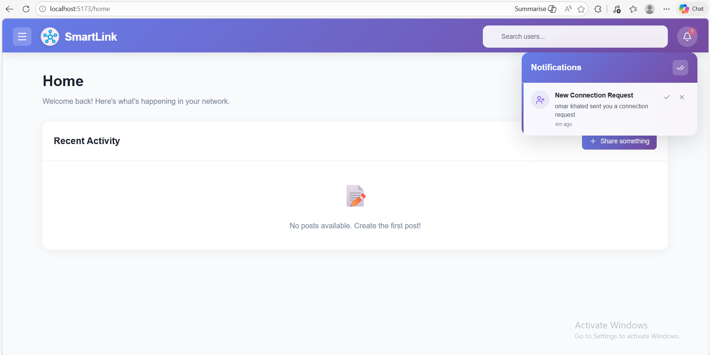

<div align="center">

# SmartLink

### Professional Networking Platform

A full-stack LinkedIn-inspired platform connecting job seekers and companies — featuring AI-powered job recommendations, real-time messaging, CV analysis, a rich social feed, and a complete admin portal.

---

**React 19** · **Spring Boot 3.5** · **FastAPI** · **MySQL** · **Redis** · **Google Gemini** · **WebSocket**

</div>

---

## Table of Contents

- [Overview](#overview)
- [Tech Stack](#tech-stack)
- [Features](#features)
- [Screenshots](#screenshots)
- [Architecture](#architecture)
- [Getting Started](#getting-started)
- [Environment Configuration](#environment-configuration)
- [Running with Docker](#running-with-docker)
- [API Reference](#api-reference)
- [Testing](#testing)
- [Project Structure](#project-structure)

---

## Overview

SmartLink bridges the gap between job seekers and employers through a rich social platform. Users build detailed profiles, post updates, connect with peers, apply for jobs, and receive AI-ranked recommendations tailored to their skills and education. Companies get a dedicated portal to post jobs and manage applications. Admins oversee the entire platform through a secure dashboard.

---

## Tech Stack

### Frontend
| Technology | Version | Purpose |
|---|---|---|
| React + Vite | 19 / 7 | UI framework and build tool |
| React Router | v7 | Client-side routing |
| Tailwind CSS | 3.4 | Utility-first styling |
| MUI (Material UI) | 7 | Component library |
| Axios | 1.13 | HTTP client |
| STOMP.js + SockJS | 7.2 / 1.6 | WebSocket real-time communication |
| jsPDF | 3.0 | CV analysis PDF export |
| Lucide React | 0.555 | Icon library |

### Backend
| Technology | Version | Purpose |
|---|---|---|
| Spring Boot | 3.5.7 | Core application framework |
| Spring Security + JWT (JJWT) | 0.11.5 | Authentication & authorization |
| Spring Data JPA + MySQL | — | Relational data persistence |
| Spring WebSocket (STOMP) | — | Real-time messaging & notifications |
| Spring GraphQL | — | Flexible job querying |
| Spring OAuth2 Client | — | Google social login |
| Spring Mail | — | Email verification & password reset |
| Redis (Jedis) | 7.2 | Caching AI job recommendations |
| Google Gemini API (gemini-2.5-flash) | 1.0 | AI job recommendations |
| Lombok | — | Boilerplate reduction |
| JaCoCo | 0.8.8 | Code coverage (≥ 65% line coverage enforced) |

### AI Microservice (Python)
| Technology | Purpose |
|---|---|
| FastAPI | REST API for CV analysis |
| Google Gemini API | CV scoring and structured feedback |
| PyMuPDF | PDF text extraction |

---

## Features

### Job Seekers
- **Authentication** — Email/password signup with email verification, Google OAuth2 login, and password reset via email
- **Rich Profile** — Education, work experience, skills with proficiency levels, projects, and location
- **Social Feed** — Create posts with media attachments, react (Like, Love, Haha, Wow, Sad, Angry), comment, and report inappropriate content
- **Connections** — Send, accept, and withdraw connection requests; browse your professional network
- **Job Search** — Filter by title, experience level, job type, location type, and salary range via GraphQL
- **AI Job Recommendations** — Gemini-powered ranking using a weighted scoring formula (50% semantic similarity + 30% skill match + 20% education match), cached in Redis
- **CV Analysis** — Upload a PDF resume, receive an AI score (0–10), strong points, weak points, and improvement suggestions; export the full report as PDF
- **Real-time Messaging** — WebSocket-based direct messaging with any user
- **Notifications** — Live notifications for connections, reactions, comments, and job updates

### Companies
- **Separate Auth Flow** — Dedicated registration and login for employer accounts
- **Company Profile** — Logo, banner, description, overview, office locations, and follower count
- **Job Management** — Create, update, and delete job listings with salary range, deadline, experience level, and job type
- **Application Management** — Review applicants and update status: `PENDING` → `REVIEWED` → `ACCEPTED` / `REJECTED`

### Admins
- **Secure Portal** — Role-based access, `ADMIN` role required for all `/admin/**` endpoints
- **User Management** — View all users, enable or disable accounts
- **Content Moderation** — Review reported posts and remove violating content
- **Platform Stats** — Total users, active users, and admin count

---

## Screenshots

### Landing Page
The entry point where users choose to join as a job seeker or a company.


---

### User Profile
Job seekers showcase their education, experience, skills, and projects. Connections are visible directly from the profile.


---

### Creating a Post
Users compose posts with text and media attachments, visible across their professional network.


---

### Post Feedback — Reactions & Comments
Users interact with posts through emoji reactions (Like, Love, Haha, Wow, Sad, Angry), comments with optional image attachments, and a report flow for inappropriate content.


---

### Deleting a Post
Post authors can delete their own content directly from the feed with a confirmation prompt.


---

### Network Page
Discover and manage professional connections — send, accept, or withdraw requests.


---

### Notifications
Real-time notifications powered by WebSocket keep users updated on connections, reactions, comments, and job activity.



---

### CV Analysis
Upload a PDF resume and specify a target position. Gemini AI scores the CV and returns strong points, weak points, and improvement suggestions — exportable as a PDF report.


---

### Company Login
Dedicated authentication flow for company accounts, separate from job seeker login.


---

### Company Registration
Companies register with their details to access the employer portal.


---

### Admin Portal Login
Secure login page exclusively for platform administrators.


---

### Admin Dashboard
High-level overview of platform stats — total users, active users, and admin count — with quick-action navigation.


---

### User Management
Admins view, enable, and disable user accounts across the platform.


---

### Content Moderation
Admins review reported posts and remove content that violates platform guidelines.


---

## Architecture

```
SmartLink/
├── frontend/                          # React + Vite SPA              → port 5173
├── backendVscode/                     # Spring Boot REST + GraphQL + WebSocket → port 8080
│   └── src/main/python/resumeAnalyzor/  # FastAPI CV microservice      → port 8000
├── images/                            # Project screenshots
└── sql_scripts/                       # Database initialization scripts
```

**Request Flow**

```
Browser (React SPA)
    │
    ├── REST / GraphQL  ──────────────► Spring Boot (port 8080)
    │                                       │
    ├── WebSocket (STOMP) ────────────►     ├── MySQL  (JPA)
    │                                       ├── Redis  (AI cache)
    └── CV Analysis ──────────────────►     └── Google Gemini (AI recommendations)
            │
            └── FastAPI (port 8000)
                    └── Google Gemini (CV scoring)
```

Media uploads (profile pictures, post attachments) go directly to **Cloudinary** from the browser.

---

## Getting Started

### Prerequisites

| Requirement | Version |
|---|---|
| Java | 17+ |
| Maven | 3.9+ |
| Node.js + npm | 18+ |
| MySQL | 8+ |
| Redis | any (or use Docker Compose) |
| Python | 3.10+ |

---

### 1. Database Setup

Run the SQL scripts in order from your MySQL client:

```sql
source sql_scripts/SmartLink.sql
source sql_scripts/company_script.sql
source sql_scripts/posts_integration.sql
source sql_scripts/message_Script.sql
```

---

### 2. Backend

```bash
cd backendVscode

# Configure your credentials in:
# src/main/resources/application.properties

mvn clean install
mvn spring-boot:run
```

API available at `http://localhost:8080`

---

### 3. Frontend

```bash
cd frontend
npm install
npm run dev
```

App available at `http://localhost:5173`

---

### 4. CV Analysis Microservice

```bash
cd backendVscode/src/main/python/resumeAnalyzor

pip install fastapi uvicorn python-dotenv pymupdf

# Create environment file
echo "GEMINI_API_KEY=<your_gemini_api_key>" > .env

uvicorn main:app --reload --port 8000
```

Microservice available at `http://localhost:8000`

---

## Environment Configuration

### Backend — `src/main/resources/application.properties`

```properties
# Database
spring.datasource.url=jdbc:mysql://localhost:3306/smartlink
spring.datasource.username=<your_db_user>
spring.datasource.password=<your_db_password>

# JWT
jwt.secret=<your_long_random_secret_key>
jwt.expiration-ms=86400000

# Google OAuth2
spring.security.oauth2.client.registration.google.client-id=<your_google_client_id>
spring.security.oauth2.client.registration.google.client-secret=<your_google_client_secret>

# Email (Gmail SMTP)
spring.mail.username=<your_gmail_address>
spring.mail.password=<your_gmail_app_password>

# Google Gemini
Gemini_key=<your_gemini_api_key>

# Redis
spring.data.redis.host=localhost
spring.data.redis.port=6379

# CORS
app.cors.allowed-origins=http://localhost:5173
app.frontend.base-url=http://localhost:5173
app.backend.base-url=http://localhost:8080
```

### Frontend — `.env`

```env
VITE_API_BASE_URL=http://localhost:8080
VITE_CV_ANALYSIS_API_URL=http://localhost:8000
VITE_FRONTEND_BASE_URL=http://localhost:5173
VITE_CLOUDINARY_UPLOAD_URL=https://api.cloudinary.com/v1_1/<your_cloud_name>/auto/upload
```

---

## Running with Docker

A `docker-compose.yml` is provided to spin up Redis and the Spring Boot app together:

```bash
cd backendVscode
docker-compose up --build
```

| Container | Port |
|---|---|
| `smartlink-redis` | 6379 |
| `smartlink-app` (Spring Boot) | 8080 |

> Ensure MySQL is running and accessible before starting the containers.

---

## API Reference

### REST Endpoints — Spring Boot (port 8080)

| Domain | Base Path | Auth Required |
|---|---|---|
| Authentication | `/auth/**` | No |
| User Profile | `/api/profiles/**` | No |
| Posts | `/Post/**` | No |
| Comments | `/comment/**` | No |
| Reactions | `/reactions/**` | No |
| Connections | `/api/connections/**` | No |
| Jobs | `/jobs/**` | No |
| Job Applications | `/apply/**` | No |
| Company Profile | `/api/company/**` | No |
| Messaging | `/api/messages/**` | No |
| Notifications | `/api/notifications/**` | No |
| Search | `/api/search/**` | No |
| AI Recommendations | `/gemini/**` | No |
| WebSocket | `/ws/**` | No |
| Admin | `/admin/**` | Yes — `ADMIN` role |

### GraphQL — `POST /graphql`

```graphql
query {
  allJobs(filter: {
    title: "Engineer"
    experienceLevel: MID
    jobType: FULL_TIME
    locationType: REMOTE
    minSalary: 50000
    maxSalary: 120000
  }) {
    jobId
    title
    companyName
    salaryMin
    salaryMax
    deadline
    isApplied
  }
}
```

**Available enums:**

| Enum | Values |
|---|---|
| `ExperienceLevel` | `ENTRY` `JUNIOR` `MID` `SENIOR` `LEAD` `PRINCIPAL` |
| `JobType` | `FULL_TIME` `PART_TIME` `CONTRACT` `TEMPORARY` `INTERNSHIP` `FREELANCE` |
| `LocationType` | `REMOTE` `ONSITE` `HYBRID` |

### CV Analysis Microservice — FastAPI (port 8000)

| Method | Endpoint | Description |
|---|---|---|
| `POST` | `/analyze-cv` | Upload PDF + target position, returns AI analysis |
| `GET` | `/health` | Health check |

**Response shape:**
```json
{
  "overall_score": 7.5,
  "strong_points": ["..."],
  "weak_points": ["..."],
  "improvements_needed": ["..."],
  "summary": "..."
}
```

---

## Testing

JaCoCo enforces a minimum of **65% line coverage** on every build.

```bash
cd backendVscode

# Run all tests
mvn test

# Generate HTML coverage report
mvn test jacoco:report
# Report output: target/site/jacoco/index.html
```

**Test coverage includes:**

| Category | Examples |
|---|---|
| Service unit tests | Auth, Post, Job, Connection, Notification, Gemini, Redis |
| Controller integration tests | MockMvc for all REST controllers |
| DTO & entity validation | All request/response objects |
| Security tests | JWT filter, OAuth2, SecurityConfig |

---

## Project Structure

```
SmartLink/
│
├── frontend/src/
│   ├── Components/          # Feature components (Profile, Jobs, Admin, Messages, CV, etc.)
│   ├── PostCard/            # Post display — reactions, comments, report modal
│   ├── PostComposotion/     # Post creation UI
│   ├── JobPage/             # Company job management UI
│   ├── hooks/               # useAlert, useWebSocket
│   ├── contexts/            # AlertContext (global notifications)
│   └── config.js            # Centralized API URL configuration
│
├── backendVscode/src/main/java/com/example/auth/
│   ├── config/              # Security, JWT, CORS, WebSocket, OAuth2, Redis
│   ├── controller/          # REST controllers
│   ├── dto/                 # Request / Response DTOs
│   ├── entity/              # JPA entities
│   ├── enums/               # ApplicationStatus, JobType, ReactionType, etc.
│   ├── exceptions/          # Global exception handlers
│   ├── repository/          # Spring Data JPA repositories
│   ├── service/             # Business logic
│   └── utility/             # Constants, Redis key helpers
│
├── backendVscode/src/main/python/resumeAnalyzor/
│   ├── main.py              # FastAPI app entry point
│   ├── services/            # cvAnalyzer.py, textExtractor.py
│   └── models/              # Pydantic response models
│
└── sql_scripts/             # Database initialization scripts
```

---

## CI/CD

GitHub Actions (`.github/workflows/maven.yml`) automatically builds and runs the full test suite on every push to the repository.

---

## License

Developed as part of a Software Design course. All rights reserved by the SmartLink team.
